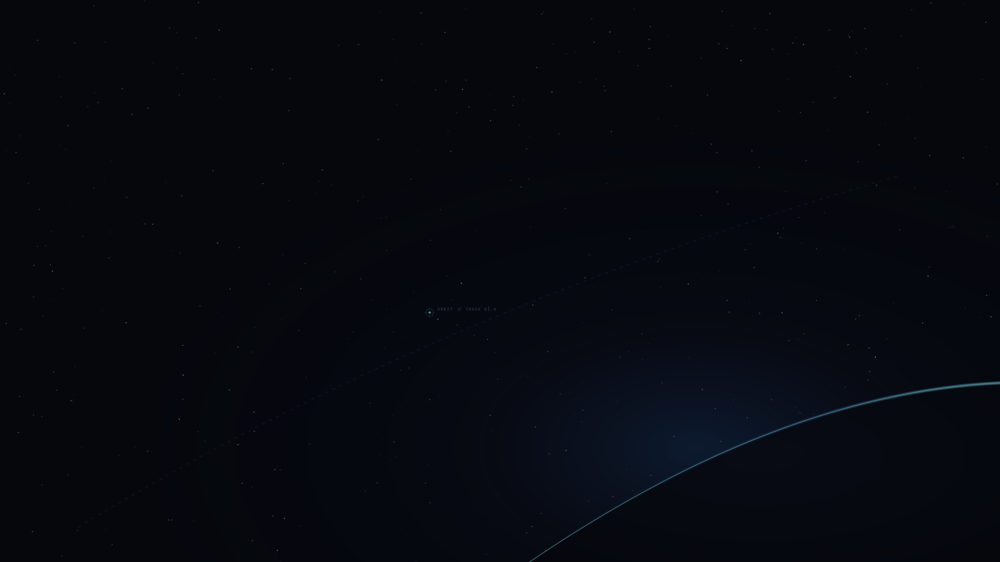

# AEGIS — Deep Space Command Center

<div align="center">

```
     ___     ______   _______  __      _______.
    /   \   |   ____| /  _____||  |    /       |
   /  ^  \  |  |__   |  |  __  |  |   |   (----`
  /  /_\  \ |   __|  |  | |_ | |  |    \   \    
 /  _____  \|  |____ |  |__| | |  |.----)   |   
/__/     \__\_______| \______| |__|_______/     
                                                
    DEEP SPACE COMMAND CENTER // OMARCHY LINUX
```

**An immersive, high-contrast, technical workstation theme for Omarchy Linux, Arch Linux, Hyprland, and Wayland.**

[](https://omarchy.org)
[](https://hyprland.org)
[](#-color-architecture)
[](#-curated-wallpaper-collection)
[](LICENSE)

<br/>



</div>

---

## 🛰️ Overview

**AEGIS** transforms the Omarchy Linux desktop into an advanced deep-space command console. Conceptualized for systems programmers, cybersecurity engineers, and operators who require a quiet, technical, and distraction-free environment, AEGIS captures the atmosphere of working aboard an advanced orbital or deep-space observation workstation.

### Core Design Principles

- **Calm & Focused:** Replaces loud neon glow with deep space darks and controlled telemetry accents to reduce ocular fatigue during long sessions.
- **Precise Semantics:** Every hue carries distinct functional meaning—cyan for active telemetry, mission blue for structure and navigation, amber for elevated metrics, restrained red for critical alerts, and emerald for healthy states.
- **Believable Technical Aesthetic:** Clean geometry, orbital coordinates, and authentic NASA imagery rather than pseudo-hacker decorations.
- **High Readability:** Validated at **15.08:1 contrast** (exceeding WCAG AAA standards) across editors, terminals, and diagnostic monitors.
- **Native Omarchy 4.x Integration:** Uses Omarchy's native `colors.toml` schema and template compilation for automatic hot-reloading across apps.

---

## 🎨 Color Architecture

The AEGIS palette provides clear visual hierarchy and distinct semantic roles:

| Token | Hex | Semantic Role | Usage Across Environment |
|---|---|---|---|
| `dark_background` | `#05070D` | Absolute Base | Deep space void canvas, root surface |
| `background` | `#080B14` | Primary Surface | Terminal and Neovim editor canvas |
| `lighter_background` | `#0D1220` | Secondary Surface | Inactive panels, dividers, meter tracks |
| `selection` | `#1B2540` | Active Surface | Visual selections, btop highlighted processes |
| `foreground` | `#D9E2F2` | Primary Text | Crisp cool-white text (15.08:1 contrast) |
| `light_foreground` | `#93A1B8` | Secondary Text | Metadata, status line items, secondary labels |
| `muted` | `#5E6B80` | Muted Text | Syntax comments, line numbers, subtle guidelines |
| `accent` | `#74D7E8` | Primary Accent (Ice Cyan) | Active window border, telemetry reticles, focus |
| `cursor` | `#A5EEF5` | Bright Accent | Terminal cursor, active line numbers |
| `blue` | `#3E6FA8` | Mission Blue | Structural syntax, functions, border gradient |
| `purple` | `#8876B8` | Cosmic Purple | Types, keywords, network upload metrics |
| `green` | `#6FBF9C` | Emerald Success | Verified states, healthy telemetry, git additions |
| `yellow` | `#D6A85E` | Amber Warning | Attention indicators, search matches, elevated load |
| `red` | `#D16969` | Restrained Red | Critical alerts, compiler errors, destructive states |

### Hyprland Window Borders
- **Active Window:** `rgba(74d7e8ee) rgba(3e6fa8ee) 45deg` (Ice cyan to mission blue dual gradient)
- **Inactive Window:** `rgba(141b2daa)` (Muted graphite blue)

---

## 🌌 Curated Wallpaper Collection

AEGIS includes **16 calibrated wallpapers** rendered at **2560×1440 (16:9)**. The collection pairs authentic scientific imagery from NASA/ESA deep space missions with bespoke vector telemetry artwork:

| # | Filename | Name | Provenance & Description |
|:---:|---|---|---|
| **01** | `01-command-center.png` | **The Command Center** | *Primary Wallpaper.* Atmospheric planetary curve with telemetry vectors and deep negative space. |
| **02** | `02-earth-from-orbit.jpg` | **Earth from Orbit** | Apollo 17 "Blue Marble" Hasselblad scan (NASA `as17-148-22727`). |
| **03** | `03-deep-space.jpg` | **Deep Space** | Hubble Ultra Deep Field (NASA/ESA `PIA12110`) revealing thousands of primordial galaxies. |
| **04** | `04-carina-nebula.jpg` | **Carina Nebula** | James Webb Space Telescope NIRCam image of the "Cosmic Cliffs" in NGC 3324. |
| **05** | `05-lunar-surface.jpg` | **Lunar Surface** | Apollo 11 lunar regolith with dramatic crater shadows (NASA `as11-40-5875`). |
| **06** | `06-orbital-station.jpg` | **Orbital Station** | ISS Cupola observation module overlooking the void (NASA `iss042e078481`). |
| **07** | `07-satellite-telemetry.jpg` | **Satellite Telemetry** | GRACE twin satellites measuring gravitational telemetry in polar orbit (NASA/JPL). |
| **08** | `08-earth-at-night.jpg` | **Earth at Night** | Nile River basin & Mediterranean city lights from orbit (NASA Earth Observatory). |
| **09** | `09-starfield-minimal.png` | **Starfield Minimal** | Sparse, calm stellar distribution on `#05070D` void canvas for distraction-free coding. |
| **10** | `10-cosmic-horizon.jpg` | **Cosmic Horizon** | Cassini wide-angle view of Saturn's limb and ring shadows (NASA/JPL `PIA08351`). |
| **11** | `11-scientific-observation.jpg` | **Scientific Observation** | James Webb Space Telescope beryllium-gold primary mirror array (NASA/GSFC). |
| **12** | `12-cosmic-blue-abstract.png` | **Cosmic Blue Abstract** | Geometric orbital trajectory paths and gravitational resonance fields. |
| **13** | `13-the-void.png` | **The Void** | Maximum negative space isolation canvas with faint cosmic micro-dust. |
| **14** | `14-nebula-purple.jpg` | **Nebula Purple** | Bubble Nebula NGC 7635 captured in deep infrared wavelengths (NASA/JPL/WISE). |
| **15** | `15-deep-space-exploration.jpg` | **Deep Space Exploration** | Voyager spacecraft traversing the interstellar medium beyond the heliosphere. |
| **16** | `16-aegis-signature.png` | **AEGIS Signature** | Orbital telemetry platform observing Earth's limb, with precision navigation reticles. |

*Full license details and NASA asset URLs are documented in [SOURCES.md](SOURCES.md).*

---

## 🛠️ Themed Applications & Environments

AEGIS coordinates across the entire Omarchy workspace:

- **Desktop Shell (Quickshell):** Top status bar, workspace indicators, application launcher, notifications, popups, and lock screen.
- **Window Management (Hyprland):** Dual-tone ice cyan & mission blue active borders, graphite inactive borders.
- **Terminals (Foot & Alacritty):** Deep-space background, full ANSI 16-color table, visible cursor, and distinct selection.
- **Editor (Neovim):** Automatically loaded and hot-reloaded via `aether.nvim` and LazyVim, with syntax highlighting for C, C++, Rust, Python, Assembly, Lua, Web, and LSP diagnostics.
- **System Telemetry (btop):** Dedicated telemetry dashboard styling CPU, Memory, Disk, and Network monitoring graphs.
- **Shell (Zsh & Starship):** Ice cyan prompt characters, muted pathing, and responsive git status.
- **Browsers & Icons:** Dark browser policy (`#080B14`) and `Yaru-blue-dark` icon theme.

---

## 📥 Installation

Choose any of the following methods to install AEGIS on your system:

### Method 1: Using the Omarchy Theme Manager (Recommended)

Run the official Omarchy theme installer with the repository URL:

```bash
omarchy theme install https://github.com/<username>/omarchy-aegis-theme.git
```

This automatically clones the theme into your user themes directory, compiles the required templates, and applies the theme immediately.

### Method 2: Manual Git Clone

Clone the repository directly into your Omarchy themes directory:

```bash
git clone https://github.com/<username>/omarchy-aegis-theme.git ~/.config/omarchy/themes/aegis
```

Then apply the theme:

```bash
omarchy theme set aegis
```

### Method 3: Local Repository Symlink (For Local Clones)

If you have cloned the repository to a local directory (e.g., `~/projects/omarchy-aegis-theme`):

```bash
mkdir -p ~/.config/omarchy/themes
ln -s ~/projects/omarchy-aegis-theme ~/.config/omarchy/themes/aegis
omarchy theme set aegis
```

---

## 🚀 Usage & Commands

Once installed, AEGIS can be managed using standard Omarchy commands:

### Activating the Theme
```bash
# Via CLI:
omarchy theme set aegis

# Or via the interactive visual picker:
omarchy theme switcher
```

### Cycling & Selecting Wallpapers
```bash
# Cycle to the next wallpaper in the collection:
omarchy theme bg next

# Or open the interactive wallpaper gallery:
omarchy background
```

### Verifying Color Contrast
Inspect the palette and contrast ratios in your terminal:
```bash
omarchy-dev-theme-preview aegis
```

---

## ⚙️ Customization

AEGIS is built entirely on standard TOML configuration. To adjust any colors or border values to your liking:

1. Open `~/.config/omarchy/themes/aegis/colors.toml` in your editor:
   ```bash
   nvim ~/.config/omarchy/themes/aegis/colors.toml
   ```
2. Modify any hex code (for example, tweak `accent`, `selection`, or ANSI colors).
3. Reapply the theme to instantly propagate changes across all applications:
   ```bash
   omarchy theme set aegis
   ```

---

## 🔄 Rollback & Uninstallation

AEGIS does not modify system files and can be reverted or uninstalled cleanly at any time:

### Switching to Another Theme
To switch back to any bundled or installed theme:
```bash
omarchy theme set "Tokyo Night"
# Or: omarchy theme set "Catppuccin", "Nord", "Gruvbox", etc.
```

### Removing AEGIS
1. Switch away from AEGIS first:
   ```bash
   omarchy theme set "Catppuccin"
   ```
2. Remove the theme using Omarchy or delete the directory:
   ```bash
   omarchy theme remove aegis
   # Or manually:
   # rm -rf ~/.config/omarchy/themes/aegis
   ```

---

## 📋 System Requirements

- **Operating System:** Omarchy Linux 4.x / Arch Linux
- **Compositor:** Hyprland (Wayland)
- **Shell / UI:** Quickshell
- **Terminal:** Foot or Alacritty
- **Editor:** Neovim (LazyVim / `aether.nvim`)
- **System Monitor:** btop

---

## 📄 License & Attribution

- **Theme Configuration & Bespoke Artworks:** Released under the [MIT License](LICENSE).
- **Space Photography:** Public Domain works of the U.S. Federal Government created by NASA, ESA, CSA, and STScI. See [SOURCES.md](SOURCES.md) for individual image IDs, missions, and attribution links.
